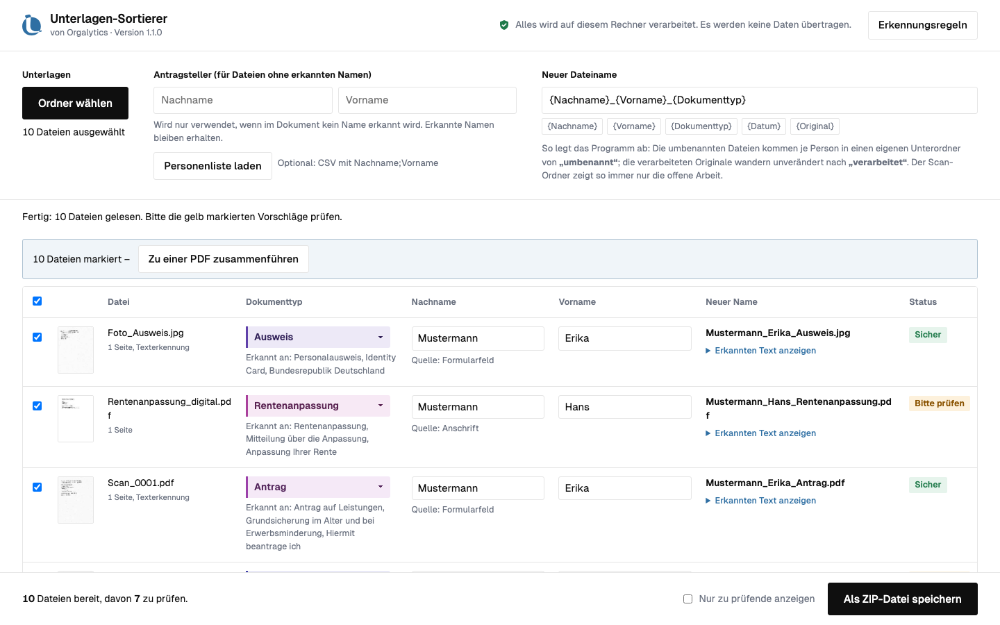
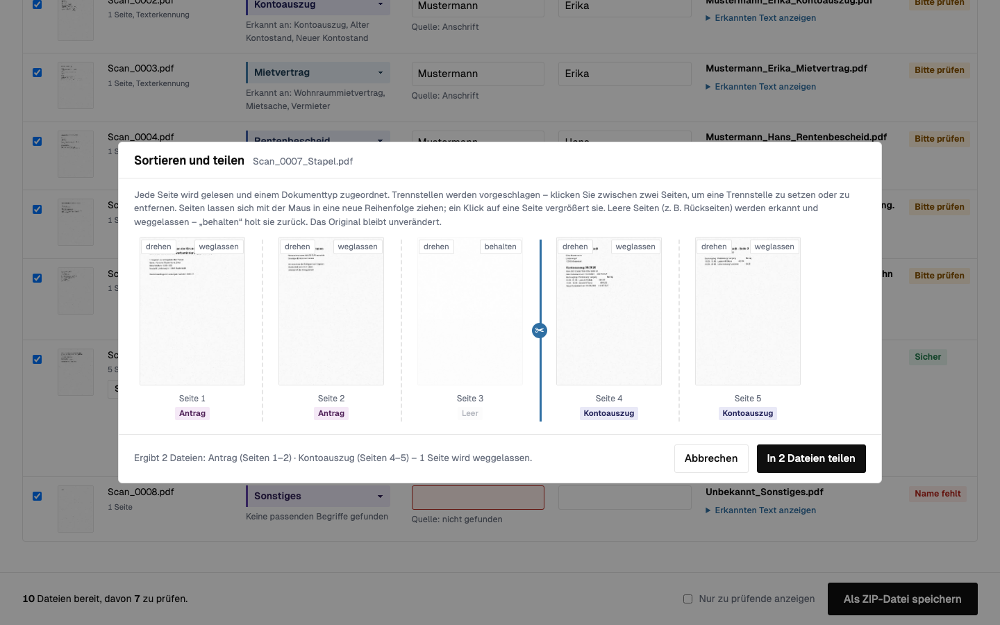

# Unterlagen-Sortierer

[](https://github.com/timvonorgalytics/unterlagen-sortierer/actions/workflows/tests.yml)
[](https://github.com/timvonorgalytics/unterlagen-sortierer/releases/latest)
[](LICENSE)

Ein Offline-Werkzeug für Service Points in Verwaltungen (Sozialamt, Grundsicherung):
Es liest eingescannte Antragsunterlagen (PDF/JPG/PNG), erkennt **Dokumenttyp** und
**Person** und benennt die Dateien einheitlich um — z. B.
`Scan_0001.pdf → Mustermann_Erika_Antrag.pdf`. Die so benannten Dateien lassen sich
direkt per Drag & Drop in die eAkte ziehen, wo der Dateiname sofort sagt, was drin ist.





## Funktionen

- **Erkennen & Umbenennen:** Dokumenttyp über editierbare Suchbegriffe (24 Typen ab Werk),
  Person über Formularfelder, Anschrift, Absender oder Briefanrede;
  Dateinamen-Muster frei kombinierbar; Ampel-Status je Datei, alles von Hand korrigierbar;
  verdreht eingescannte Seiten werden automatisch erkannt, gerade angezeigt und gerade gespeichert
- **Stapel-Scans teilen:** Seitenvorschau mit Zoom, automatisch vorgeschlagene Trennstellen,
  leere Rückseiten werden erkannt und weggelassen — Originale bleiben unverändert
- **Zusammenführen:** mehrere Dateien (auch Fotos) zu einer PDF verbinden
- **Mehrere Personen & laufender Betrieb:** Unterordner je Person, „Neue Dateien einlesen“
  für laufend eintreffende Scans, verarbeitete Originale wandern nach `verarbeitet/`
- **Nachvollziehbar:** nie überschreiben, Excel-taugliches Protokoll-CSV je Durchgang
- **100 % offline:** keine einzige Netzanfrage, automatisiert getestet —
  siehe [Datenschutz auf einen Blick](Unterlagen-Sortierer/programm/Datenschutz.txt)

## Schnellstart

1. Das aktuelle Release-ZIP herunterladen und entpacken.
2. **Doppelklick auf `Unterlagen-Sortierer.html`** — die einzige Datei im obersten
   Ordner. Öffnet sich dabei nicht Edge oder Chrome, liegen in `programm/` zwei
   Start-Helfer (`Start mit Edge.bat` für Windows, `Start mit Chrome oder
   Edge.command` für macOS — dort beim ersten Mal per Rechtsklick → „Öffnen“).
3. Ordner mit den Scans wählen (oder Dateien ins Fenster ziehen), Vorschläge prüfen,
   speichern: Die umbenannten Kopien landen je Person in einem Unterordner von
   `umbenannt/`, die Originale wandern nach `verarbeitet/`. Fiktive Beispiel-Scans
   liegen in `programm/Beispiel-Scans/`.

Keine Installation, keine Adminrechte, kein Internet nötig, keine Einstellungen.
Vollen Funktionsumfang (direkt im Ordner arbeiten) bieten Edge und Chrome; andere
Browser speichern das Ergebnis als ZIP-Datei.

## Anpassen (ohne Programmierung)

| Datei | Zweck |
| --- | --- |
| `Unterlagen-Sortierer/programm/regeln.js` | Dokumenttypen und Suchbegriffe, Standard-Dateinamenmuster |
| `Unterlagen-Sortierer/programm/marke.js` | Name, Farben, Logo, Fußzeile (Corporate Design) |

Details: `programm/Hinweise fuer die IT.txt` und `programm/LIESMICH.txt`.
Der Knopf **„Erkennungsregeln“** im Programm zeigt alle aktiven Begriffe an.

## Entwicklung

```bash
python3 -m pip install playwright pillow reportlab   # einmalig
python3 -m playwright install chromium                # einmalig
bash tests/alle_tests.sh                               # alle Tests (~150 Prüfungen)
bash tools/release_bauen.sh                            # Auslieferungs-ZIP bauen
```

Die gesamte Oberfläche und Logik steckt in `Unterlagen-Sortierer/Unterlagen-Sortierer.html`
(eine Datei, kein Framework, kein Build-Schritt). Eingebettete Bibliotheken werden
mit `tools/bibliotheken_bauen.sh` aus festgepinnten npm-Paketen erzeugt.
Entwicklungs-Leitfaden: [CLAUDE.md](CLAUDE.md) · Änderungen: [CHANGELOG.md](CHANGELOG.md)

## Lizenz und Dank

[MIT](LICENSE) © 2026 Orgalytics · Kontakt: office@orgalytics.de

Der Unterlagen-Sortierer steht auf den Schultern großartiger Open-Source-Projekte —
herzlichen Dank an [pdf.js](https://mozilla.github.io/pdf.js/) (Mozilla),
[Tesseract.js](https://github.com/naptha/tesseract.js) und
[Tesseract](https://github.com/tesseract-ocr/tesseract),
[pdf-lib](https://pdf-lib.js.org/) sowie die Schriften
[Geist](https://vercel.com/font) (Vercel) und
[Lora](https://github.com/cyrealtype/Lora-Cyreal) (Cyreal).
Die zugehörigen Lizenztexte liegen in `Unterlagen-Sortierer/programm/lib/lizenzen/`
und werden mit jeder Auslieferung mitgegeben.
